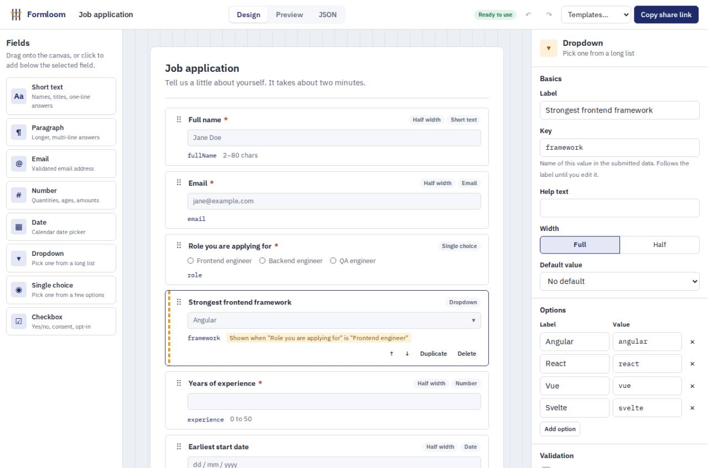
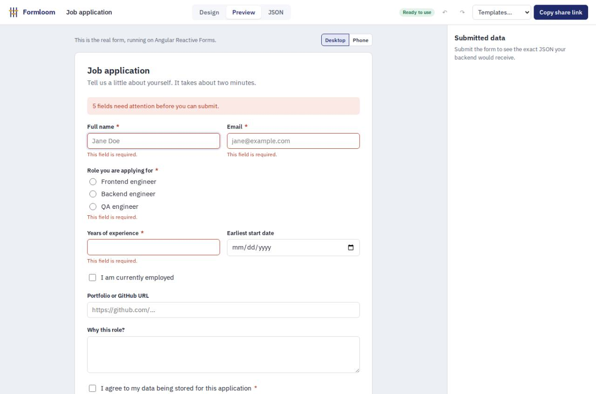

# Formloom

[](https://github.com/maithreya-sharma/formloom/actions/workflows/ci.yml)


**A drag-and-drop form builder.** You design a form visually, add validation and show/hide rules, try it
as a real Angular Reactive Form, and share it as a link. There's no backend.

**[Open the live app](https://maithreya-sharma.github.io/formloom/)**



---

## What it does

- **Design.** Drag field types onto the canvas, reorder them by dragging or with the keyboard, and
  edit labels, keys, placeholders, defaults, widths and options in the inspector.
- **Validate.** Required, min/max length, numeric range, and regex patterns with custom messages.
- **Add logic.** Show a field only when another field meets a condition: *is*, *contains*, *is greater
  than*, *is checked* and so on. Chains like A → B → C collapse correctly.
- **Catch mistakes early.** A live linter flags duplicate keys, broken regexes, min > max, rules that
  point at deleted fields, and more. Each card on the canvas shows its own problems.
- **Preview.** The real form, built at runtime as a typed `FormGroup`, at desktop or phone width. Submit
  it to see exactly what your API would receive.
- **Share.** The whole form is compressed into the URL. Open the link anywhere and the form loads, with no
  server or database.
- **Import / export.** Copy or download the schema as JSON, or paste JSON in. Imports are validated, with
  precise error paths like `fields[2].type`.
- **Undo / redo.** Full history with `Ctrl+Z` / `Ctrl+Shift+Z`. Typing a word counts as one step,
  not one step per keystroke.
- **Autosave.** Your work is kept in the browser between visits.



---

## How it works

One **JSON schema** is the single source of truth. Every view is a function of it.

```
                       ┌────────────────────────────┐
  Palette / Canvas ───▶│  BuilderStore (signals)    │◀─── Inspector
  Templates / Import   │  schema · history · lint   │
  Share link           └──────────────┬─────────────┘
                                      │ computed()
          ┌───────────────────────────┼───────────────────────────┐
          ▼                           ▼                           ▼
   Canvas + issue badges     buildForm(schema) → FormGroup     JSON / share link
                             + watchVisibility()
```

A few decisions worth calling out:

| Decision | Why |
| --- | --- |
| **Immutable schema in a signal store, history as snapshots** (`core/state/builder-store.ts`) | Undo/redo is just moving between snapshots. `computed()` dependents (linting, preview, JSON) only recompute when something actually changed. |
| **Edits to the same property within 800 ms merge into one undo step** | Undo restores the previous *word*, not the previous keystroke, the way editors are expected to behave. |
| **Rules reference fields by stable `id`, not by `key`** (`core/schema/form-schema.ts`) | Renaming a field's key never silently breaks the rules that depend on it. |
| **Hidden fields are *disabled*, not just hidden** (`core/forms/form-factory.ts`) | Angular then skips their validators and leaves them out of `form.value`, so a hidden required field can't block submission or leak stale data. |
| **Rules may only depend on fields above them** | Keeps logic acyclic and readable, and lets visibility be computed in a single ordered pass. |
| **Untrusted JSON is parsed, not cast** (`core/schema/schema-io.ts`) | Imports and share links go through type guards that normalize missing properties and report precise errors, instead of `as FormSchema`. |
| **Share links use the native `CompressionStream`** (`core/share/share-codec.ts`) | Deflate plus base64url keeps a whole form in a URL with zero dependencies, with a plain fallback for older browsers. |
| **The inspector holds no state of its own** | Every control reads a signal and writes through a store method, so the canvas, preview, JSON and history can't drift apart. |

### Built with

Angular 21 (standalone components, signals, zoneless change detection, `@if`/`@for`/`@let`,
`input()`/`output()`, route-to-input binding, lazy-loaded routes) · typed Reactive Forms · RxJS ·
Angular CDK drag-and-drop · SCSS with design tokens and dark mode · strict TypeScript

---

## Testing

- **Unit tests (Jasmine + Karma):** schema parsing and linting, condition evaluation, the form
  factory, the share codec, the store (undo/redo, coalescing, key derivation, rule cleanup on delete),
  and the inspector, renderer, JSON view and app shell components.
- **End-to-end (Playwright):** `e2e/smoke.mjs` drives the production build in Chromium. It builds a form
  from scratch, drags from the palette, uses undo/redo, submits the preview with conditional fields,
  imports bad JSON, opens a share link in a fresh browser and checks autosave.
- **CI/CD (GitHub Actions):** every push runs unit tests, a production build and the end-to-end test
  against the build served exactly as GitHub Pages serves it. Pushes to `main` then deploy.

---

## Run it locally

Requires Node 20.19+ or 22.12+.

```bash
npm install
npm start               # http://localhost:4200
npm test                # unit tests
npm run build           # production build in dist/
```

To run the end-to-end test against a running app:

```bash
npm i --no-save playwright && npx playwright install chromium
node e2e/smoke.mjs http://localhost:4200
```

## Project structure

```
src/app/
├── core/
│   ├── schema/   form-schema.ts (types) · field-factory · conditions · schema-io (parse + lint)
│   ├── forms/    form-factory.ts: schema → typed FormGroup, validators, visibility
│   ├── state/    builder-store.ts (signals + history) · templates
│   ├── share/    share-codec.ts: schema ⇄ compressed URL-safe string
│   └── ui/       toast service
└── features/
    ├── design/   palette + canvas (CDK drag-drop) · field card · inspector
    ├── preview/  form renderer · submitted data
    └── json/     export · import with validation
```

---

Built by **Maithreya Sharma Mangalampalli** ·
[LinkedIn](https://www.linkedin.com/in/maithreya-sharma-mangalampalli) ·
[GitHub](https://github.com/maithreya-sharma)
